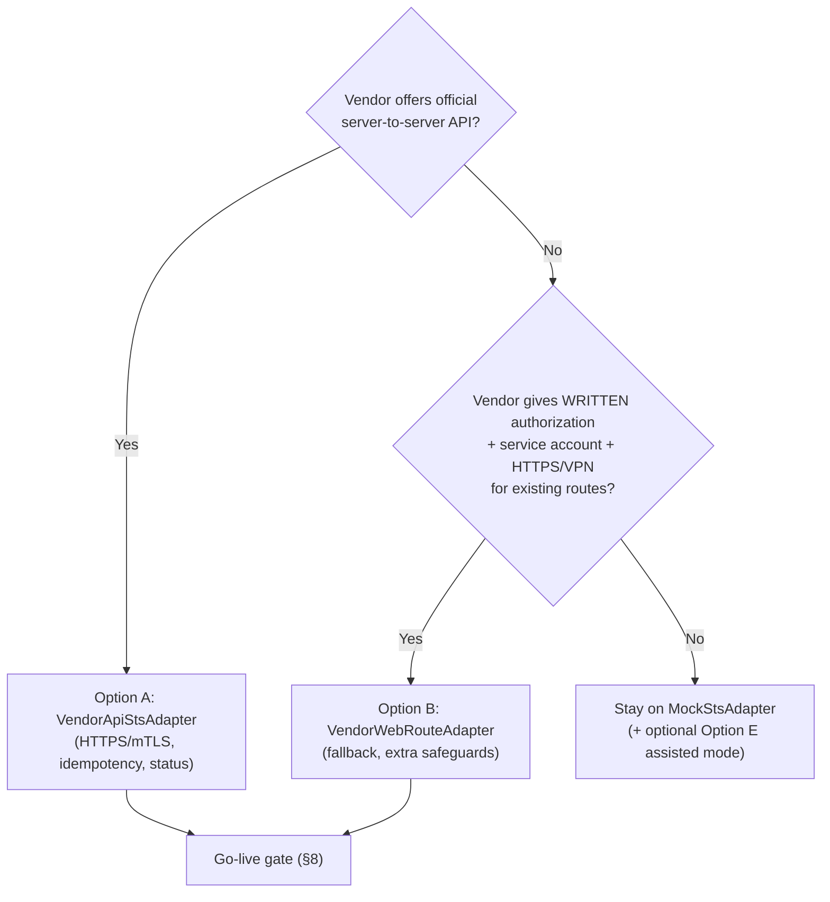
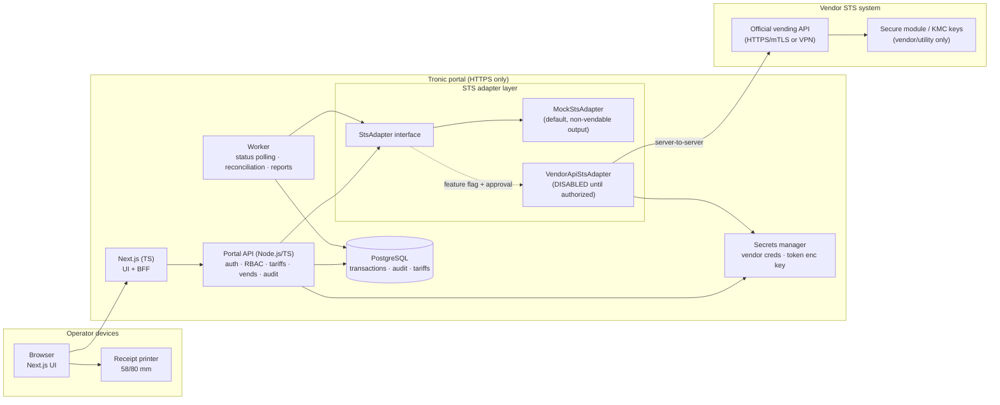
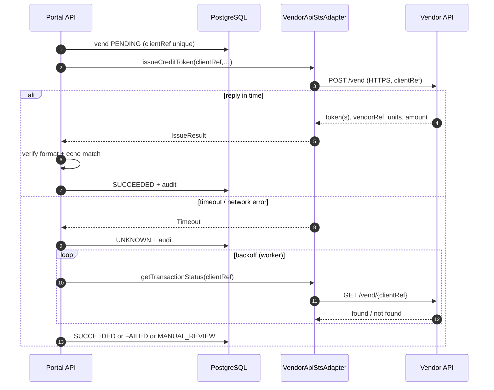
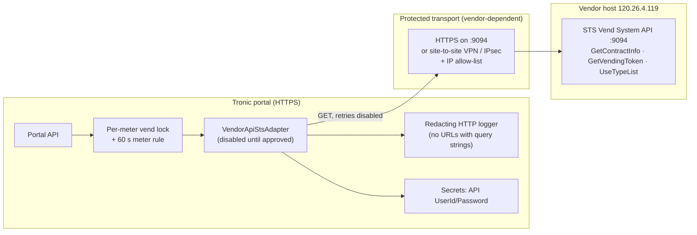

# STS Integration Feasibility, Security and Recommended Architecture

**Date:** 2026-10-30
**Question:** What is the safest, technically viable way to connect the new Tronic portal to the existing, authorized STS vending service **without rebuilding the vending engine**?

---

## 1. Feasibility conclusion (short)

| Question | Answer |
|---|---|
| Can the portal be built now? | **Yes** — fully, against a **mock STS adapter**. Everything except real token issuance can be built and tested. |
| Can the portal issue real tokens today? | **No.** There is no known authorized server-to-server interface. The only known interface is the operator web UI over plain HTTP. |
| Is calling the internal web routes from a backend acceptable? | **No.** It needs login automation or reuse of a browser session, has no idempotency, runs over cleartext HTTP, and is an undocumented contract that can change at any time. It is also outside the authorization the user holds (an operator login). |
| What unblocks live vending? | The vendor provides an **official API** (or written authorization + a documented contract + service account) over **HTTPS/VPN**, with **idempotency** and a **status query**. |
| Recommended path | **Adapter pattern**: portal → `StsAdapter` interface → `MockStsAdapter` now → `VendorApiStsAdapter` once the vendor grants access. Live adapter disabled by default. |

---

## 2. Integration options evaluated

| # | Option | Verdict | Why |
|---|---|---|---|
| A | **Vendor's official server-to-server API** (REST/SOAP, API key or mTLS, HTTPS/VPN) | ✅ **Recommended** | Authorized, supportable, can carry idempotency keys and status queries. |
| B | Vendor-authorized use of the existing `/ElectricManage/...` routes with a **dedicated service account**, in writing, behind HTTPS or VPN | ⚠️ Fallback only | Acceptable only with written vendor + utility approval, a documented contract, a non-human account, TLS, and a vendor commitment not to change routes without notice. Still lacks idempotency unless the vendor adds it. |
| C | Backend logs in as a user / reuses browser cookies / headless browser automation | ❌ Rejected | Violates the analysis limits and likely the vendor's terms; stores a human password; brittle; no idempotency; cleartext. |
| D | Build our own STS vending engine (SM/HSM, KMC keys) | ❌ Out of scope | Requires utility key-management agreements, certified secure module, STS Association compliance. Explicitly not to be rebuilt. |
| E | "Assisted manual" interim: operator vends in the vendor UI; portal records the transaction and prints its own receipt | ⚠️ Optional stopgap | No integration risk, but double keying, human error and token handling by hand. Only if the business must operate before option A exists. |



---

## 3. Security analysis of the existing interface

### 3.1 Official server-to-server API
**Not Found.** No evidence either way. Ask the vendor (most Chinese/African STS vending products — the route style here suggests such a product — offer a "third-party vending API" for banks and mobile-money aggregators; that is the channel to request).

### 3.2 Limits of session-based auth
- Sessions belong to a **human operator**; using them for a backend breaks accountability (all portal vends would appear as one person).
- Sessions expire; an expired session typically yields a login redirect/HTML — a backend could misread this as success or failure.
- Requires storing the operator password or a live cookie in the backend — **not acceptable**.
- Concurrency: one session shared by many portal users may be invalidated by a single-login policy.

### 3.3 CORS and CSRF
- **CORS:** The portal must **never** call the vendor from the user's browser. All vendor calls go server-to-server, so CORS is irrelevant to the design. Existing CORS headers: Unknown.
- **CSRF (existing system):** Unknown whether JSON actions validate an anti-forgery token. If they do not, any web page an operator visits while logged in could potentially trigger a vend. This is a **risk to report to the vendor**, not something to test.
- **CSRF (portal):** SameSite=Lax/Strict session cookies + CSRF token on state-changing requests, or bearer tokens held server-side by Next.js (BFF pattern).

### 3.4 TLS
- The target is **plain HTTP** on port 9110. Passwords, sessions and every token transit in cleartext; tokens could be intercepted and redeemed by someone else (a token works on its meter for whoever types it first).
- **Requirement:** any integration channel must be HTTPS (TLS 1.2+) with a valid certificate, or run inside a site-to-site VPN / private link. The portal itself must be HTTPS-only (HSTS).

### 3.5 Idempotency and duplicate-token prevention
- Existing vend request has no idempotency key and the response has no reference number → **a retry after a timeout can create a second token and a second debit**.
- Portal controls (independent of vendor):
  1. `Idempotency-Key` per Generate click (UUID created when the quote is shown); unique DB constraint.
  2. One in-flight vend per meter (DB advisory lock / unique partial index on `meter_no WHERE status IN ('PENDING','SUBMITTED','UNKNOWN')`).
  3. Soft duplicate rule: same meter + same amount within N minutes needs supervisor confirmation.
  4. Button disabled after click; server is the source of truth.
  5. **No automatic retry** of a vend once the request may have reached the vendor.
- Vendor controls required: accept `clientRef` and return the original result when the same `clientRef` is repeated.

### 3.6 Timeouts and reconciliation
- Connect timeout ~5 s, read timeout ~30–45 s (tune with vendor SLA).
- On timeout → `UNKNOWN`; query `getTransactionStatus(clientRef)` with backoff; if no status API, flag `MANUAL_REVIEW`.
- Daily reconciliation: import the vendor's vend report (API or file) and match on `clientRef`/`vendorRef`, meter, units, amount. Mismatches go to a reconciliation queue. Totals per operator per day.

### 3.7 Credential storage
- Vendor API credentials (API key, client cert/private key) in a secrets manager or at minimum environment variables injected at runtime — never in the repo, never in the database in clear, never in logs.
- Rotate on staff change and at least every 90 days; separate credentials for sandbox and production.
- STS tokens stored in the portal DB **encrypted at the column level** (AES-256-GCM, key from KMS/env), masked in lists (`XXXX XXXX XXXX XXXX 1234`), full view/reprint permission-gated and audited.
- Portal user passwords: Argon2id; MFA for admin/supervisor.

### 3.8 Audit logging
- Append-only `audit_events` table (no UPDATE/DELETE grants for the app role), each row hashing the previous row (tamper evidence).
- Log: login/logout/failed login, meter verify, quote, vend request/response **metadata** (never full token, never credentials), reprint, tariff changes (before/after), user/role changes, exports.
- Structured app logs with redaction filters for `token`, `password`, `authorization`, `cookie`.

### 3.9 Permissions
| Role | Can |
|---|---|
| Cashier / Vendor | Verify meter, quote, generate token, print/reprint own receipts (same day) |
| Supervisor | All cashier actions, approve duplicates, resolve `UNKNOWN`/manual review, reprint any |
| Admin | Users, roles, tariffs (with maker-checker), adapter settings (not live-enable alone) |
| Auditor | Read-only history, audit log, reports, exports |

Live adapter enablement requires two people (maker-checker).

---

## 4. Recommended integration architecture



### 4.1 Adapter contract (portal side)

```ts
export interface StsAdapter {
  readonly mode: 'mock' | 'live';
  verifyMeter(meterNo: string): Promise<MeterVerification>;
  issueCreditToken(req: {
    clientRef: string;        // portal transaction UUID, also the idempotency key
    meterNo: string;
    units: string;            // decimal string, kWh
    amount: string;           // decimal string, minor-unit safe
    currency: 'KES' | 'TZS' | 'UGX' | 'RWF';
  }): Promise<IssueResult>;   // { tokens[], vendorRef, units, amount, tid?, raw? }
  getTransactionStatus(clientRef: string): Promise<StatusResult>; // may return 'unsupported'
  health(): Promise<{ ok: boolean; latencyMs: number }>;
}
```

`MockStsAdapter` returns a deterministic, **non-numeric sentinel** such as `MOCK 0000 0000 0000 0042` derived from a DB sequence — not random digits and not keyable into a meter — so a mock token can never be mistaken for a real one.

### 4.2 End-to-end sequence with failure handling



---

## 5. Verified findings
- Existing system is HTTP-only; vend is a single session-authenticated JSON POST returning the token directly with no reference number.

## 6. Assumptions
- The vendor product has (or can provide) a third-party vending API.
- The portal operator (Tronic) is, or will be, an authorized vending agent of the utility/vendor.

## 7. Missing information
- Existence and documentation of an official API; sandbox; SLA; vendor report formats; whether CSRF/CORS protections exist on the current system.

## 8. Vendor-dependent requirements and go-live gate
Live adapter may be enabled only when **all** are true:
1. Written authorization from the vendor (and utility where required) naming Tronic as an integrator.
2. Documented API with idempotency (`clientRef`) and status query.
3. HTTPS with valid certificate or VPN; credentials issued to a **service** identity.
4. Sandbox certification passed (test meters, error cases, timeouts, duplicate replay).
5. Reconciliation report format agreed and tested.
6. Two-person approval recorded in the portal; `STS_LIVE_ENABLED=true` set in production config.

## 9. Production blockers
1. No authorized integration channel (blocks all live vending).
2. Cleartext HTTP on the only known interface.
3. No idempotency / status query.
4. Tariff authority (portal vs vendor) not agreed.
5. Legal: agent agreement, data-protection obligations (Kenya DPA 2019, Tanzania PDPA 2022, Uganda DPPA 2019, Rwanda Law 058/2021).

---

## 10. Revised feasibility after finding the published API (2026-10-30)

The vendor host publishes an **"STS Vend System API"** on port 9094 (`STS_API_DOCUMENTATION.md` §7). This moves the project from "no channel exists" to "**a channel exists, but it is not yet safe or authorized to use in production**".

| Question | Revised answer |
|---|---|
| Official server-to-server API? | **Yes, documented:** `GetContractInfo` (verify meter), `GetVendingToken` (vend by amount or quantity), `UseTypeList` (tariff categories). |
| Is Tronic authorized to call it? | **Unknown.** Requires written vendor confirmation and an API account issued to Tronic. The operator web login must **not** be reused for the API unless the vendor says so in writing. |
| Is it safe as-is? | **No.** Plain HTTP with the password in the URL; token issuance via `GET`; no idempotency, no status query, no electricity history. |
| Can the portal still be built now? | **Yes**, on the mock adapter — now shaped exactly like the documented API. |

### 10.1 Recommended integration architecture (revised)



### 10.2 Adapter rules specific to this API

1. **Allow-list exactly three operations:** `GetContractInfo`, `GetVendingToken` (`MeterType=1`), `UseTypeList`. The adapter has no code path to clear-credit, clear-tamper, max-power, key-change, meter register/update/delete or use-type management.
2. **No automatic retries** on `GetVendingToken` at any layer (HTTP client, proxy, service mesh). A timeout → `UNKNOWN`, never a re-send.
3. **Per-meter lock:** at most one in-flight vend per meter, and no new vend for the same meter within **60 s** of the last one (the meter rejects a second token generated in the same minute with `USED` — manual §3.3). Recommend a 5-minute soft lock with supervisor override.
4. **Never log request URLs** for this host (they contain the password). Log operation name, meter (masked), latency, `code`, and a request hash.
5. **Credentials** only from the secrets store; rotate after any staff change; dedicated vend-only account.
6. **Transport:** live mode refuses to start unless the base URL is `https://` **or** the host is on an allow-listed VPN/private route. Plain-Internet HTTP is not allowed in production.
7. **Resolving `UNKNOWN`:** no API exists today. Interim procedure: supervisor checks the vendor web UI history (by a human, in their own session) or asks the customer to read the meter's last-tokens short code (50–59 / 250–299 — manual §4.2) before any re-vend. Request an electricity history/status operation from the vendor.
8. **Verify responses:** `code` indicates success, `data` contains exactly 20 digits (after removing spaces), and — when the vendor documents it — echoed meter/units/amount match the request.
9. **Unit choice:** use `VendingType=0` (amount) when the operator enters money, `1` (quantity) when they enter kWh; portal quote shown as advisory until the vendor's computed value is returned.

### 10.3 Updated production blockers
1. Written authorization + vend-only API account (blocks live mode).
2. HTTPS or VPN for port 9094 (blocks live mode).
3. Documented response schemas and error codes (blocks adapter completion — sandbox or sanitized sample responses needed).
4. A status or electricity vend-history operation (blocks safe timeout handling; interim manual procedure possible).
5. Hosting on IIS 7.5 (Windows Server 2008 R2 era) — ask the vendor about patching; a risk, not a hard blocker for Tronic.
