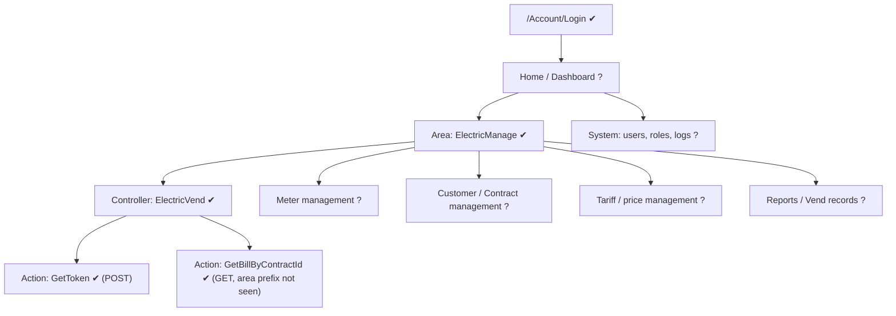
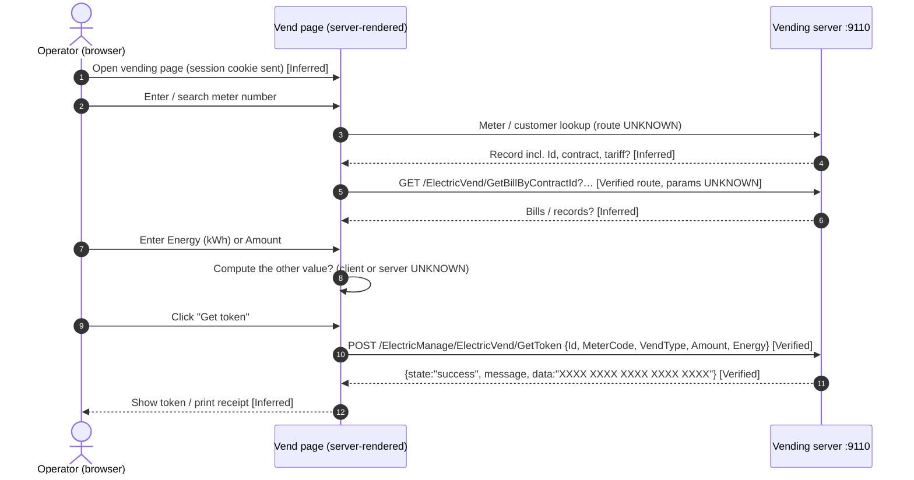

# STS Vending System — Passive Analysis Report

**Target:** `http://120.26.4.119:9110/Account/Login` (existing STS electricity prepayment vending web app)
**Purpose:** Understand the existing system well enough to plan the standalone *Tronic STS Electricity Token Generation Portal*, without rebuilding the vending engine.
**Date:** 2026-10-30
**Status of this report:** **Preliminary — no live inspection has been performed.**

---

## 0. Evidence status (read this first)

| Source | Available? | Notes |
|---|---|---|
| Chrome DevTools endpoint `http://127.0.0.1:9222` (REA) | **No** | `list_browser_targets` returned `endpoint_unreachable` on 2026-10-30. No Chrome instance was running with remote debugging. |
| Sanitized HAR exports | **No** | None found in Downloads, Desktop, Documents, `D:\T-TZ` or `%TEMP%`. |
| Screenshots | **No** | None supplied. |
| Notes from the user (prior observation) | **Yes** | Two routes and one request/response shape (see §2). Values are illustrative only. |
| **Vendor OpenAPI document** `http://120.26.4.119:9094/swagger/v1/swagger.json` | **Yes (added 2026-10-30)** | "STS Vend System API" v1, supplied by the user. Documentation only was read; no operation was called. See §11 and `STS_API_DOCUMENTATION.md` §7. |
| **Meter user manual** "L type user manual" (12 pp., scanned) | **Yes (added 2026-10-30)** | Single-phase STS keypad prepayment meter manual. See §12. |
| Chrome debug window for passive observation | Open, user not yet logged in | Separate profile `C:\ChromeSTS`, loopback-only. Nothing observed yet. |

Everything in this report is therefore built from **the user's two observations plus general knowledge of STS (IEC 62055-41) and of ASP.NET-style web apps**. Nothing here was captured from the live system by this session. Each statement is tagged:

- **[Verified]** — reported by the user from their own browser observation.
- **[Inferred]** — reasoned from verified facts; plausible but unconfirmed.
- **[Unknown]** — needs a capture or a vendor answer.

The capture checklist that would turn the inferences into verified facts is in §7.

---

## 1. Scope and safety limits applied

- Read-only, passive analysis. No login automation, no vending, no fuzzing or scanning, no auth bypass.
- No STS keys, credentials, cookies, auth tokens, customer data or generated tokens are recorded in this report or any sibling document.
- This session did **not** navigate to the target, did not request any URL on it, and did not drive any UI.
- Recommendations never include copying browser session cookies into a backend.

---

## 2. Verified findings

| # | Finding | Source |
|---|---|---|
| V1 | The application is served over **plain HTTP** on a non-standard port (`9110`) at a raw IP address. | URL supplied by user |
| V2 | Login page route is `/Account/Login`. | URL supplied by user |
| V3 | Token generation is a browser XHR/fetch call: `POST /ElectricManage/ElectricVend/GetToken`. | User observation |
| V4 | `GetToken` request body is JSON with keys `Id`, `MeterCode`, `VendType`, `Amount`, `Energy`. In the observed request `VendType` was the number `0`, while `Amount` (`"1781.200"`) and `Energy` (`"5.0"`) were **strings**. | User observation |
| V5 | `GetToken` response is a JSON envelope `{ state, message, data }`; on success `state = "success"`, `message = "Get token successfully"`, and `data` is the token as **five space-separated groups of four digits** (20 digits). | User observation |
| V6 | A second route exists: `GET /ElectricVend/GetBillByContractId`. Parameters and purpose are not known. | User observation |
| V7 | The token is returned **synchronously in the same response** as the vend request (no polling step was observed). | User observation (V5) |

---

## 3. Architecture (Phase 1)

### 3.1 Frontend technology

| Aspect | Assessment | Tag |
|---|---|---|
| Server framework | `/Account/Login` plus `/{Area}/{Controller}/{Action}` routes (`/ElectricManage/ElectricVend/GetToken`) are the default conventions of **ASP.NET MVC / ASP.NET Core MVC with Areas**. | Inferred |
| Rendering | Server-rendered pages (Razor views) with jQuery/AJAX or a UI kit (e.g. layui, EasyUI, Bootstrap admin template) calling JSON actions. The `{state, message, data}` envelope is typical of such admin templates. | Inferred |
| SPA? | No evidence of a SPA framework. | Unknown |
| Hosting | `120.26.x.x` appears to be in a public-cloud range (commonly attributed to Alibaba Cloud). Do not rely on this; ask the vendor. | Inferred |
| TLS | None on this endpoint. | Verified (V1) |

### 3.2 Navigation modules (expected, not observed)

The `ElectricManage` area and `ElectricVend` controller suggest a module layout like the one below. Only the two nodes marked ✔ are observed.



### 3.3 Workflows

| Workflow | What is known | Tag |
|---|---|---|
| Meter lookup | Some step must produce the `Id` and confirm `MeterCode` before `GetToken`, because `Id` is sent alongside `MeterCode`. The route is not known. | Inferred |
| Vending | Operator enters units (`Energy`) and/or money (`Amount`); browser posts both to `GetToken`; token comes back in `data`. | Verified (shape) / Inferred (UI) |
| Billing | `GetBillByContractId` likely returns bill / vend records for a customer contract — possibly the source for receipt or history. | Inferred |
| Receipt | No receipt endpoint observed. The receipt may be rendered client-side from the `GetToken` response plus page data, or fetched via `GetBillByContractId`. | Unknown |

### 3.4 API call sequence (best current reconstruction)



### 3.5 Sessions and authentication (high level)

| Item | Assessment | Tag |
|---|---|---|
| Login | HTML form at `/Account/Login`. | Verified (route) |
| Session carrier | Most likely an HTTP-only cookie (ASP.NET forms-auth / ASP.NET Core cookie auth), sent automatically with XHR calls. | Inferred |
| Anti-forgery | ASP.NET apps often use `__RequestVerificationToken` on form posts; JSON actions frequently do **not** validate it. | Unknown |
| Cleartext exposure | Because the site is plain HTTP, the login password, the session cookie and every generated token cross the network unencrypted. | Verified consequence of V1 |
| Roles / permissions | Not observed. | Unknown |

### 3.6 Frontend validation rules

None observed. Expected checks to confirm in a capture: meter number length (STS meters are typically 11 or 13 digits), numeric-only, min/max amount, decimal places (the observed `Amount` has 3 decimals, `Energy` 1 decimal), and whether `Energy` or `Amount` is the driving field.

---

## 4. Observations about the observed data

- **Amount/Energy ratio.** The illustrative values give 1781.200 ÷ 5.0 = **356.24 per kWh**. That equals 292 × 1.22 exactly, which is consistent with a flat base rate plus about 22 % of combined charges (for example 18 % VAT + 3 % + 1 % levies, a structure used in Tanzania). This is **one illustrative data point and may be coincidence**; it must not be used as a tariff. It does suggest the tariff is a flat rate with percentage add-ons, not stepped blocks — to be confirmed.
- **Both `Amount` and `Energy` are sent by the browser.** It is unknown whether the server recomputes one from the other or trusts the client. If it trusts the client, that is a weakness in the *existing* system and the new portal must never depend on it.
- **No transaction ID in the response.** The success response carries only the token. Without a server reference number, retries and reconciliation are hard (see `STS_INTEGRATION_ARCHITECTURE.md` §4).
- **`Id` is sent by the client** but is almost certainly a **server-issued record ID** (meter, customer or contract row) obtained from an earlier lookup — not a per-transaction idempotency key. If it were a transaction key, the server would have issued it before the vend; no such call was seen.

---

## 5. Assumptions

1. The existing system is a vendor-supplied product with its own STS key management (SMS/HSM). The portal will **not** replicate this.
2. The user's account is an operator/vendor account with authority to vend; it is not an API account.
3. Every call to `GetToken` creates a **new** token (new STS Token Identifier) and a new debit — i.e. the endpoint is **not** idempotent.
4. Tariffs are configured server-side in the existing system.

---

## 6. Missing information

- Meter verification / lookup route and response.
- Parameters and response of `GetBillByContractId`.
- Meaning of `Id` and of each `VendType` value.
- Error responses of `GetToken` (`state` values other than `success`, HTTP codes).
- Whether a receipt / reprint, transaction-status, or history endpoint exists.
- Session lifetime, CSRF handling, CORS headers.
- Whether the vendor offers an official server-to-server API.

---

## 7. What to capture next (user action required)

Because the browser endpoint was not available, nothing was inspected live. Two ways to proceed — pick one.

### Option A — Passive observation window with REA (preferred)

1. Close Chrome, then start a **separate** Chrome profile with remote debugging on loopback only:
   ```
   "C:\Program Files\Google\Chrome\Application\chrome.exe" --remote-debugging-port=9222 --user-data-dir=C:\ChromeSTS
   ```
2. In that window **log in yourself** at `http://120.26.4.119:9110/Account/Login`. Tell me when you are on the home page — I will not observe the login step.
3. I start a passive `inspect_web_page` window (`observation_ms`, JSON *shapes* only, storage keys redacted). During that window, you click through, in this order:
   - the vending page, then **search an existing meter** (do not generate a token);
   - open the customer/contract view for that meter;
   - open the bill / vend-history view (this should trigger `GetBillByContractId`);
   - open the **reprint receipt** of an **existing past** transaction, if the UI offers it;
   - open the tariff / price page, if your role can see it;
   - type an invalid meter number (e.g. too short) and submit the lookup, to see the validation error.
4. Do **not** click "Get token" / vend during the window.

### Option B — Sanitized HAR + screenshots (if you prefer not to enable debugging)

Do the same clicks as in Option A step 3 with DevTools → Network open, **Preserve log** on, filter **Fetch/XHR**, then:

| # | File | What it should contain | Redact before sharing |
|---|---|---|---|
| H1 | `sts_lookup.har` | The meter search request + response | Use Chrome's **Export HAR (sanitized)**; replace meter numbers, names, phone numbers, addresses with `X` |
| H2 | `sts_bills.har` | `GetBillByContractId` request + response | Same; replace any token in responses with `XXXX…` |
| H3 | `sts_receipt.har` | Reprint of an old receipt | Same; mask token |
| H4 | `sts_tariff.har` | Tariff/price page data | Nothing sensitive expected |
| H5 | `sts_validation.har` | Invalid-meter lookup error | — |
| S1–S6 | Screenshots | Main menu, vending form (empty), receipt layout (values blurred), history list (values blurred), tariff page, error message | Blur all customer data and tokens |

**Never include** the login POST, `Cookie` / `Set-Cookie` headers, `Authorization` headers, passwords or real tokens. If the HAR file still contains a `Cookie` header after sanitized export, delete those lines or don't send it.

---

## 8. Vendor-dependent requirements

- Official server-to-server API (or written permission plus a documented contract for the web routes).
- Test/sandbox environment and test meters.
- Definitions of `VendType`, `Id`, error codes, and the reference number returned for each vend.
- HTTPS (or VPN / private link) for any integration.

Full list: `STS_VENDOR_API_REQUIREMENTS.md`.

## 9. Production blockers

1. **No authorized integration channel.** The only known interface is the operator web UI. Calling its internal routes from another server would mean automated login or session reuse, which is out of scope and not authorized.
2. **Plain HTTP.** Credentials, sessions and tokens travel in cleartext.
3. **No idempotency or transaction reference** in the observed vend response → duplicate-token and reconciliation risk.
4. **No live evidence yet** for lookup, billing, receipt, status or history.

## 10. Related documents

- `STS_API_DOCUMENTATION.md` — per-endpoint contract with Observed/Inferred/Not Found status
- `STS_TOKEN_WORKFLOW.md` — Meter → Token → Receipt workflow
- `STS_INTEGRATION_ARCHITECTURE.md` — feasibility, security, recommended architecture
- `TRONIC_PORTAL_IMPLEMENTATION_PLAN.md` — build plan for the new portal
- `STS_VENDOR_API_REQUIREMENTS.md` — what to ask the vendor for

---

## 11. New evidence: published "STS Vend System API" on port 9094 (2026-10-30)

The user supplied the Swagger UI link `http://120.26.4.119:9094/swagger/index.html`. The OpenAPI document was downloaded (documentation only; **no API operation was invoked**) and saved to `evidence/sts_vend_api_swagger_v1.json`.

**What it changes**

| Earlier conclusion | Revised |
|---|---|
| "No official server-to-server API known" | A **server-to-server API exists**, published by the same host: `GetVendingToken`, `GetContractInfo`, `UseTypeList`, plus management and meter-admin operations. |
| Meter verification route Not Found | `GET /api/Power/GetContractInfo` (Documented) |
| Tariff: Not Found | `GET /api/UseType/UseTypeList` likely lists tariff categories (Inferred) |
| `VendType 0` meaning unknown | API `VendingType`: **0 = amount, 1 = quantity** — web `VendType 0` very likely = vend by amount (Inferred) |
| Frontend tech: ASP.NET inferred | Host serves `Server: Microsoft-IIS/7.5`, `X-Powered-By: ASP.NET` on the API port (Observed) |

**What it does not change**

- The API is plain HTTP and takes the **account password in the query string** of every call.
- Token issuance is a `GET` with **no idempotency key**, and there is **no status or electricity-history operation**.
- Using it still requires the vendor's **authorization and an API account** — a publicly visible Swagger page is not permission to integrate.

Details and security notes: `STS_API_DOCUMENTATION.md` §7; revised feasibility: `STS_INTEGRATION_ARCHITECTURE.md` §10.

## 12. New evidence: meter user manual ("L type", single-phase STS keypad prepayment meter)

Facts relevant to the portal (Verified from the manual; applies to this meter model only):

| # | Manual statement | Consequence for the portal |
|---|---|---|
| M1 | Designed to IEC 62052-11, 62053-21/31, **62055-41 and 62055-51**; 20-digit STS tokens for credit, key change, clear tamper, etc. | Standard STS — tokens must come from the vendor's STS vending system; nothing in the portal can or should generate them. |
| M2 | "One meter can only generate one charge token in one minute"; a token with the **same minute** time stamp as one already used is refused with **`USED`**. | **Two vends for the same meter within 60 s → the second token is rejected by the meter** although the customer may be charged. The portal must block a second vend for the same meter within at least 60 s (recommend 5 min soft lock + supervisor override). |
| M3 | Meter keeps the time stamps of the last **50** tokens; a token older than all of them is refused with **`OLD`**. | Unused old tokens can become invalid. Receipts should advise prompt entry; support can explain `OLD`. |
| M4 | Credit limit 999,999.99 kWh; above it the meter shows **`FULL`** but the token stays valid. | Max-vend rule in the portal; help text. |
| M5 | Overdraft (factory default 0): negative balance is deducted from the next recharge. | Customer may see fewer units than bought — receipt/help note. |
| M6 | Display messages: `ACCEPT`, `REJECT`, `USED`, `OLD`, `FULL`, `TEMPER`, `OUE_LOAD`, `V-Err`, `EMPTY`. | Use as a customer-support troubleshooting table on the receipt/help page. |
| M7 | Short codes show KRN/KT (04), TI (05), SGC (94), KEN (81), KCN (82), meter ID (92), **last 10 recharge tokens (50–59)** and **last 50 recharge tokens/energy/time (200–349)**. | Support can confirm whether a disputed token was entered — useful for reconciliation of `UNKNOWN` vends. Compare KRN/TI/SGC with `GetContractInfo` when a token is rejected. |
| M8 | Key change follows the IEC 62055-41 key-type table (DITK/DDTK/DUTK/DCTK). | Key-change tokens are a vendor/utility function — keep `GetChangeDecoderToken` out of the portal. |
| M9 | The manual prints a commissioning token and STS Class 1 test tokens. | These are standard/published tokens for installers; they are **not** reproduced in these documents and must not be offered by the portal. |

Not stated in the manual: how the vending system computes units, tariffs, or the TID-rollover / key-revision status of installed meters.
