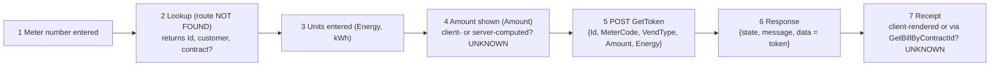
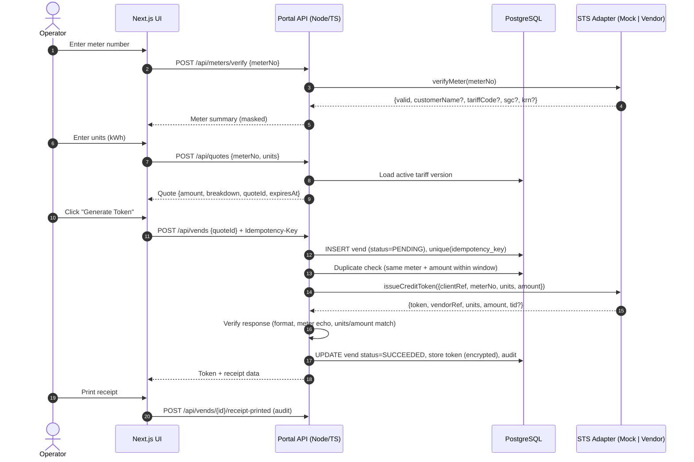
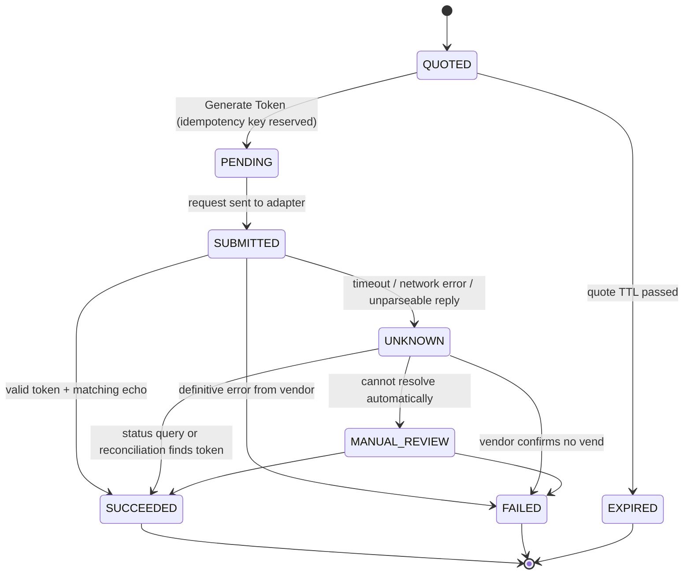

# STS Token Workflow

**Scope:** Meter → Lookup → Units → Amount → Token request → Token response → Receipt, for (a) the existing vending system as far as it is known, and (b) the new Tronic portal.
**Date:** 2026-10-30
**Evidence:** Only the user's observation of `GetToken` and the existence of `GetBillByContractId`. No live capture, no vending, no existing records were inspected by this session (browser endpoint unavailable). When captures arrive, this file should be updated from **existing records only** (lookups, history, receipt reprints) — never by generating a new token.

---

## 1. Background: what an STS token is (standard, not system-specific)

- An STS credit token is a **20-digit number** (IEC 62055-41) that encrypts: token class/subclass, a **Token Identifier (TID)** derived from the issue time, the credit amount (kWh for electricity), and a CRC. It is encrypted with a **meter-specific decoder key** derived from the vending key, the meter's supply group code, tariff index, key revision and serial number.
- Only a system holding the vending key (Secure Module / HSM under the utility's Key Management Centre) can create valid tokens. **The portal must never try to produce or imitate them.**
- A meter accepts each TID **once** — so the meter itself rejects re-entry of the *same* token. It does **not** protect against the vending server issuing **two different tokens** for one payment. Duplicate protection must therefore happen **before** the vend request.
- Tokens are often grouped 4-4-4-4-4 for display — matches the observed `data` format.
- Industry note: the STS **TID rollover** (base date reset, November 2024) requires meters to be on key revision 2+ and the vending system to be compliant. Confirm with the vendor (see `STS_VENDOR_API_REQUIREMENTS.md`).

---

## 2. Existing system — current best reconstruction



### 2.1 Field relationships

| Field | Origin | Relationship | Confidence |
|---|---|---|---|
| `MeterCode` | Typed/scanned by operator | Identifies the physical meter; used by the server to derive the decoder key. | High |
| `Id` | **Server-generated**, returned by the lookup step and echoed back by the browser | Primary key of the meter / customer / contract record linked to `MeterCode`. The server probably checks `Id` ↔ `MeterCode` consistency (unconfirmed). | Medium |
| `VendType` | Set by the page (`0` observed) | Selects the kind of vend. `0` ≈ normal credit purchase. | Medium |
| `Energy` | Operator input or computed | kWh to encode in the token. This is what the STS token actually carries. | High (STS standard) |
| `Amount` | Computed from `Energy` × tariff (or the reverse) | Money for the vend. Illustrative ratio 1781.200 / 5.0 = 356.24 per kWh — implies a flat rate with percentage charges; one data point only. | Low–Medium |
| `data` | Server | The 20-digit token, returned directly. | High |

### 2.2 Is `Id` client- or server-generated?

**Server-generated (Inferred, medium confidence).** Reasons: it is sent together with `MeterCode` (redundant if it were a client nonce), the system uses record-ID style routes (`GetBillByContractId`), and no "create transaction" call was observed before `GetToken`. To confirm: in a capture of the lookup step, the same `Id` value should appear in the lookup **response**.

### 2.3 Is the token returned directly?

**Yes (Observed).** The success response carries the token in `data`. There is no polling step and no separate "get token by transaction" call observed.

### 2.4 Is the vend idempotent?

**Assume no.** No idempotency key, no transaction reference. A retry after a timeout may issue a **second token and a second charge**.

---

## 3. New portal — target workflow

The portal owns lookup caching, tariff calculation, duplicate protection, the transaction record and the receipt. The STS adapter (mock now, vendor API later) is the **only** component that obtains tokens.



### 3.1 Transaction state machine



**Rule:** a vend in `UNKNOWN` is **never** retried automatically with a new request. It is resolved by a status query (if the vendor offers one) or by reconciliation, otherwise by a supervisor.

### 3.2 Units → Amount

- Server-side only. The UI displays the quote; it never sends a price.
- Tariff versions have effective dates; the quote records the tariff version ID.
- Formula (configurable): `amount = round(units × base_rate × (1 + Σ percentage_charges) + Σ fixed_charges, currency_decimals)`; or the inverse for vend-by-amount. Rounding mode and decimals per currency (KES/TZS/UGX/RWF) come from configuration.
- **The vendor system will apply its own tariff.** The portal quote must match the vendor's result; the response verification step compares them and flags mismatches. Until the vendor confirms how tariffs are applied, the portal's tariff is advisory.

### 3.3 Receipt content

Portal name, outlet/operator, date-time (Africa/Nairobi, Dar es Salaam, Kampala or Kigali), meter number (full on customer copy), customer name (if returned), units (kWh), amount and tax breakdown, tariff code, portal transaction number, vendor reference, **token in 4-4-4-4-4 grouping**, and a "MOCK — NOT VALID" watermark whenever the mock adapter produced it. Reprints are labelled "REPRINT", require permission, and are audited.

---

## 4. Verified findings
- Vend is one synchronous `POST` with `{Id, MeterCode, VendType, Amount, Energy}` returning the token directly.
- `VendType` is numeric; `Amount`/`Energy` are decimal strings.

## 5. Assumptions
- `Id` is a server record ID from lookup; `VendType 0` = credit vend; each call issues a new token; tariff is a flat rate with percentage charges.

## 6. Missing information
- Lookup step (route, response, whether it returns tariff/customer data).
- Whether the server recomputes `Amount` from `Energy`.
- Minimum/maximum vend, rounding, currency.
- Receipt source and reprint behaviour; history data.
- Multi-token responses (e.g. key-change tokens returned together with credit for meters needing a key update).

## 7. Vendor-dependent requirements
- Client reference / idempotency key accepted on vend.
- Vendor reference, units, amount and TID returned with the token.
- Transaction status query by client reference.
- Key-change token handling and TID-rollover compliance.

## 8. Production blockers
- No authorized server-to-server vend channel.
- No idempotency/status query → unresolved timeouts cannot be settled safely.
- Tariff authority unclear (portal vs vendor).

---

## 9. Update 2026-10-30 — mapping to the published API and meter behaviour

### 9.1 Workflow on the documented API

```mermaid
sequenceDiagram
    autonumber
    participant API as Portal API
    participant AD as VendorApiStsAdapter
    participant V as STS Vend System API :9094
    API->>AD: verifyMeter(meterNo)
    AD->>V: GET /api/Power/GetContractInfo?MeterType=1&MeterCode=…&UserId=…&Password=…
    V-->>AD: contract info (schema NOT documented)
    API->>API: quote (portal tariff, advisory) + per-meter 60 s check
    API->>AD: issueCreditToken(amount or units)
    AD->>V: GET /api/Power/GetVendingToken?MeterType=1&MeterCode=…&AmountOrQuantity=…&VendingType=0|1&UserId=…&Password=…
    V-->>AD: token (schema NOT documented; likely RichResult.data)
```

| Portal concept | Web UI field | API parameter | Status |
|---|---|---|---|
| Meter number | `MeterCode` | `MeterCode` (≤ 13 chars) | Documented |
| Record ID | `Id` | — (not needed by API) | Inferred: web-only, server-issued |
| Vend by amount / units | `VendType` (0 seen) | `VendingType` 0 = amount, 1 = quantity | Documented (API); web mapping Inferred |
| Money | `Amount` (string) | `AmountOrQuantity` when `VendingType=0` (double) | Documented |
| kWh | `Energy` (string) | `AmountOrQuantity` when `VendingType=1` | Documented |
| Meter type | (implicit) | `MeterType` 1 = electric | Documented |
| Token | `data` | probably `data` | Inferred |

Note on precision: the API takes a **double**. The portal must send a decimal string with fixed decimals (e.g. `1781.20`) built from an exact decimal type, never from floating-point arithmetic.

### 9.2 Meter behaviour that affects the workflow (from the meter manual)

- **One credit token per meter per minute.** A second token whose time stamp falls in the same minute is rejected with `USED`. → Hard rule: no second vend for the same meter within 60 s; soft rule: 5 min with supervisor override.
- **Last-50 window.** A token older than the last 50 accepted tokens shows `OLD`.
- **`FULL`** above 999,999.99 kWh; token remains valid for later.
- **Overdraft** is deducted from the next recharge.
- **Support check:** short codes 50–59 (last 10 recharge tokens) and 200–349 (last 50 recharge times/tokens/energy) let a customer or technician confirm whether a token was entered — part of the `UNKNOWN` / dispute procedure.
