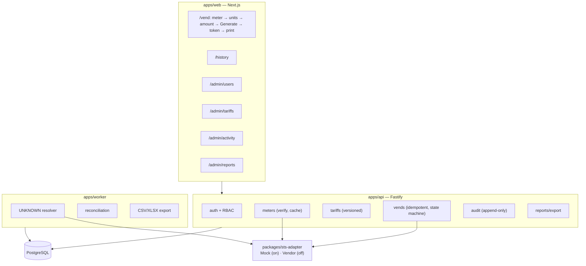
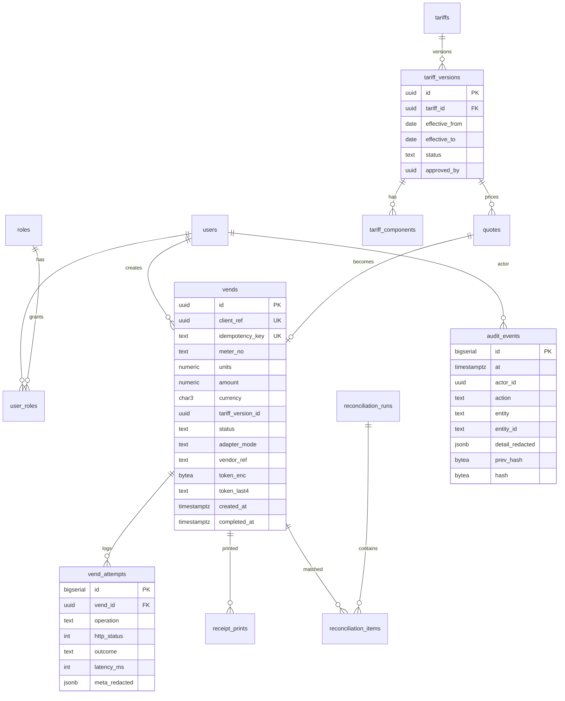

# Tronic STS Electricity Token Generation Portal — Implementation Plan

**Date:** 2026-10-30
**Principle:** Build the whole portal against a **mock STS adapter**. Keep the live adapter **disabled** until the vendor grants authorized integration access. Never generate tokens with random numbers and never replicate STS cryptography. No payment gateway.

---

## 1. Stack

| Layer | Choice | Notes |
|---|---|---|
| Frontend | **Next.js 15 (App Router) + TypeScript**, Tailwind, shadcn/ui, React Hook Form + Zod | Server Components for admin pages; BFF route handlers proxy to the API so tokens/creds never reach the browser beyond the result. |
| Backend | **Node.js 22 LTS + TypeScript**, **Fastify** (or NestJS if the team prefers DI/modules) | Separate service from Next.js so vend logic, worker and adapter are isolated. |
| ORM / migrations | Drizzle ORM or Prisma | SQL migrations reviewed in PRs. |
| Database | **PostgreSQL 16** | Transactions, audit logs, tariffs. |
| Jobs | pg-boss (Postgres-backed queue) | Status polling, reconciliation, report exports — no extra infra. |
| Auth | Session cookies (HttpOnly, Secure, SameSite=Lax) issued by the API; Argon2id; TOTP MFA for Supervisor/Admin | |
| Validation | Zod schemas shared between FE and API (`packages/contracts`) | |
| Observability | pino logs with redaction, OpenTelemetry traces, health endpoints | |
| Printing | Browser print CSS for 58 mm / 80 mm thermal + A4 PDF | ESC/POS later if needed. |
| Deployment | Docker; HTTPS via reverse proxy (Caddy/nginx) with HSTS | Hosting in-region (e.g. Dar es Salaam, Nairobi or Johannesburg) for latency and data-residency. |

### Monorepo layout

```
tronic-sts-portal/
  apps/
    web/            Next.js UI (operator + admin)
    api/            Fastify API
    worker/         background jobs
  packages/
    contracts/      Zod schemas + TS types (API DTOs)
    sts-adapter/    StsAdapter interface, MockStsAdapter, VendorApiStsAdapter (disabled)
    tariff/         pure tariff calculation (unit-tested)
    db/             schema + migrations
  docs/             the six STS_*.md documents
```

---

## 2. Architecture



---

## 3. Frontend — operator vend screen

| Element | Behaviour |
|---|---|
| Meter input | Digits only; length rule from config (11 or 13 by default); "Verify" calls `/api/meters/verify`; shows masked customer name / tariff code from adapter. |
| Units input | Decimal kWh, min/max from config; debounce → `/api/quotes`. |
| Amount | **Read-only**, from the server quote with breakdown (base, VAT, levies). Optional "vend by amount" mode computes units server-side. |
| Generate Token | Enabled only with a valid, unexpired quote. Sends `Idempotency-Key`. Disabled immediately on click; shows progress; handles `UNKNOWN` with a clear "Do not re-vend — pending confirmation" message. |
| Token display | Large monospace 4-4-4-4-4; copy button; **MOCK** banner when mock adapter. Auto-masks after N minutes. |
| Print receipt | Thermal and A4 layouts; reprint labelled "REPRINT"; every print audited. |
| Environment banner | Persistent "MOCK MODE — tokens are not valid" until live is enabled. |

Localisation: English + Kiswahili; currency per deployment (KES, TZS, UGX, RWF) with correct decimals (UGX/RWF usually 0, KES/TZS 2); time zones EAT (UTC+3) / CAT (UTC+2, Rwanda).

---

## 4. Backend API (portal-owned, not the vendor's)

| Method | Path | Role | Purpose |
|---|---|---|---|
| POST | `/auth/login`, `/auth/logout`, `/auth/mfa` | all | Session auth |
| POST | `/meters/verify` | cashier+ | Adapter `verifyMeter`, cached briefly |
| POST | `/quotes` | cashier+ | Units ↔ amount from active tariff; returns `quoteId`, TTL 5 min |
| POST | `/vends` | cashier+ | Requires `Idempotency-Key`; creates vend from quote; calls adapter |
| GET | `/vends/:id` | owner/supervisor+ | Status + receipt data |
| POST | `/vends/:id/reprint` | per policy | Audited reprint |
| POST | `/vends/:id/resolve` | supervisor | Resolve `UNKNOWN`/`MANUAL_REVIEW` with reason |
| GET | `/vends` | supervisor/auditor | History, filters |
| CRUD | `/admin/users`, `/admin/roles` | admin | User management |
| CRUD | `/admin/tariffs` (+ `/approve`) | admin + approver | Versioned tariffs, maker-checker |
| GET | `/admin/audit` | auditor/admin | Activity logs |
| POST | `/admin/reports/export` | auditor/admin | CSV/XLSX async export |
| GET | `/health`, `/health/adapter` | ops | Liveness, adapter mode + latency |

### Vend handler (pseudo-code)

```ts
async function createVend(user, quoteId, idemKey) {
  return db.tx(async (t) => {
    const existing = await t.vends.findByIdemKey(idemKey);
    if (existing) return existing;                       // replay-safe
    const q = await t.quotes.consume(quoteId, user.id);  // throws if expired/used
    await t.vends.assertNoInFlight(q.meterNo);           // one in-flight per meter
    await dupPolicy.check(t, q);                         // may require supervisor
    return t.vends.insert({ status: 'PENDING', clientRef: uuid(), idemKey, ...q });
  }).then(async (vend) => {
    if (vend.status !== 'PENDING') return vend;
    await vends.mark(vend.id, 'SUBMITTED');
    try {
      const r = await adapter.issueCreditToken({ clientRef: vend.clientRef, ... });
      verifyResponse(vend, r);                           // format, echo, units/amount
      return vends.succeed(vend.id, encrypt(r.tokens), r.vendorRef);
    } catch (e) {
      return isDefinitive(e) ? vends.fail(vend.id, e) : vends.unknown(vend.id, e);
    }
  });
}
```

---

## 5. Data model (PostgreSQL)



Key constraints:
- `UNIQUE (idempotency_key)`, `UNIQUE (client_ref)`.
- Partial unique index: one row per `meter_no` where `status IN ('PENDING','SUBMITTED','UNKNOWN')`.
- `audit_events`: app role has `INSERT, SELECT` only; hash chain verified nightly.
- `token_enc`: AES-256-GCM, key from secrets manager; key ID stored for rotation.
- Monetary columns `numeric(18,3)`; never floats.

---

## 6. Admin area

| Module | Features |
|---|---|
| Users | Create/disable, roles, MFA reset, outlet assignment, last login |
| Tariffs | Versioned tariffs with components (base rate, % charges, fixed charges), effective dates, maker-checker approval, preview calculator |
| History | Filter by date, meter, operator, status, adapter mode; detail view with attempts; resolve UNKNOWN |
| Activity logs | Audit event search; hash-chain verification status |
| Reports | Daily sales by operator/outlet, units sold, failures, UNKNOWN ageing, reconciliation differences |
| Export | CSV/XLSX, async, audited; tokens **excluded** from exports by default |
| Settings | Adapter mode (read-only display; live enable needs 2 approvals + env flag), meter length rules, limits, receipt header |

---

## 7. STS adapter rules

1. `MockStsAdapter` is the default in every environment.
2. Mock tokens are **deterministic sentinels with letters** (`MOCK 0000 0000 0000 0042`), never random digits, never STS-formatted numbers. Mock can simulate: success, meter-not-found, vendor error, timeout, slow response, duplicate replay — selectable by test meter numbers.
3. `VendorApiStsAdapter` is compiled in but refuses to start unless: `STS_LIVE_ENABLED=true`, base URL is `https://` (or VPN host allow-listed), credentials load from secrets, and an approval record exists in the DB.
4. No adapter that logs in through the vendor web UI or reuses browser cookies will be written.
5. Contract tests run the same suite against Mock and (later) vendor sandbox.

---

## 8. Delivery phases

```mermaid
gantt
    title Tronic STS Portal — indicative plan
    dateFormat  YYYY-MM-DD
    axisFormat  %d %b
    section Discovery
    Passive captures + vendor engagement       :d1, 2026-11-02, 10d
    section Build (mock)
    Foundation: repo, auth, RBAC, DB, audit    :b1, 2026-11-09, 10d
    Tariffs + quotes                            :b2, after b1, 5d
    Vend flow + state machine + mock adapter    :b3, after b2, 10d
    Receipts + printing                          :b4, after b3, 4d
    Admin: users, history, logs, reports, export :b5, after b3, 10d
    Hardening: security review, load, backups   :b6, after b5, 7d
    section Vendor-dependent
    Vendor API adapter (sandbox)                :crit, v1, after d1, 20d
    Sandbox certification                       :crit, v2, after v1, 7d
    section Launch
    UAT + pilot outlet (mock → live)            :l1, after v2, 10d
```

Vendor-dependent bars cannot start until the vendor delivers API docs and sandbox access; the mock-based build proceeds regardless.

### Definition of done per phase
- **Foundation:** login + MFA, roles enforced on every route (tests), audit events written for auth actions, HTTPS in staging.
- **Vend flow (mock):** idempotency replay test, in-flight lock test, timeout → UNKNOWN → resolved test, mock banner everywhere.
- **Admin:** maker-checker tariffs, exports without tokens, audit hash-chain check.
- **Hardening:** OWASP ASVS L2 checklist, dependency scan, backup/restore drill, log redaction test (grep logs for token patterns).
- **Live:** go-live gate in `STS_INTEGRATION_ARCHITECTURE.md` §8 fully satisfied.

---

## 9. Verified findings
- The existing vend is a single JSON POST returning the token directly; the portal adapter contract is designed to wrap an equivalent official call.

## 10. Assumptions
- Tronic will be an authorized vending agent; tariffs may be mirrored in the portal for quoting; one currency per deployment.

## 11. Missing information
- Vendor API spec, tariff authority, meter number formats in the target utility, receipt legal requirements (e.g. KRA eTIMS / TRA EFD fiscal receipts if Tronic is the seller of record).

## 12. Vendor-dependent requirements
- Official API + sandbox + test meters; idempotency; status query; reconciliation reports.

## 13. Production blockers
- No live adapter until written authorization and sandbox certification.
- Fiscal-receipt obligations (eTIMS/EFD) must be checked with an accountant before selling real tokens.
- HTTPS-only integration path.

---

## 14. Update 2026-10-30 — build against the documented "STS Vend System API"

The mock adapter should now mirror the vendor's published API (`STS_API_DOCUMENTATION.md` §7) so that switching to live is a configuration change plus response-schema mapping.

### 14.1 `packages/sts-adapter` changes

```ts
// Only these three vendor operations are ever implemented.
type VendorOp = 'GetContractInfo' | 'GetVendingToken' | 'UseTypeList';

interface VendorApiConfig {
  baseUrl: string;            // must be https:// or an allow-listed VPN host in live mode
  userId: string;             // from secrets store
  password: string;           // from secrets store, never logged
  timeoutMs: number;          // e.g. 30000
}

// VendingType: 0 = amount, 1 = quantity (vendor spec); MeterType: 1 = electric
function buildVendQuery(meterNo: string, value: Decimal, by: 'amount' | 'units') {
  return { MeterType: 1, MeterCode: meterNo, AmountOrQuantity: value.toFixed(2), VendingType: by === 'amount' ? 0 : 1 };
}
```

- HTTP client: `undici`/`fetch` with **retries disabled**, explicit timeout, no keep-alive reuse across credential rotation, and a logger that records the **path only** (never the query string).
- `MockStsAdapter` accepts the same query shape and returns a `RichResult`-like envelope `{ code, message, data }` with the non-numeric `MOCK …` sentinel; scenarios: success, meter not found, error code, timeout, slow reply.
- Contract tests assert: no management operation can be called; no retry on vend; URL never appears in logs.

### 14.2 Vend rules added to the API

| Rule | Where |
|---|---|
| No second vend for the same meter within 60 s (meter rejects same-minute tokens with `USED`) | `vends` service + DB check on `max(created_at)` per meter |
| 5-minute soft duplicate window with supervisor override | `dupPolicy` |
| Vend mode `amount` → `VendingType=0`; `units` → `VendingType=1` | quote → adapter |
| Max vend so meter credit stays under 999,999.99 kWh (practically: config max per vend) | quote validation |
| Meter number: digits, length 11 or 13 by config, ≤ 13 (vendor limit) | Zod schema |

### 14.3 Receipt / help additions (from the meter manual)

Receipt footer: "Enter the token on your meter keypad and press Enter. `ACCEPT` = success. `USED` = this token was already entered. `OLD` = token too old. `FULL` = meter credit limit reached, keep this token. `REJECT` = check the digits, then contact support." Support page lists short codes 00 (remaining credit) and 50–59 (last 10 tokens) for dispute checks.

### 14.4 Phase changes

- **Vendor API adapter** can start against the mock immediately (shape known); the **response mapping** waits for documented schemas or sanitized sample responses.
- New task in Discovery: obtain written authorization + vend-only API account + HTTPS/VPN decision.
- New Hardening checks: URL-redaction test; retry-disabled test; management-operation denial test.
