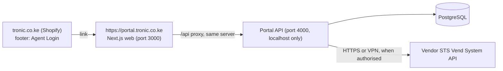

# Linking the portal from tronic.co.ke

The portal is for **staff and authorised agents only**. Customers do not buy tokens through it (there is no payment gateway). The Shopify website gets a discreet **"Agent Login"** link that opens the portal on its own subdomain.



## Why a subdomain (not a page inside Shopify)

- Shopify only hosts the storefront; it cannot run the portal's Node.js API or database.
- A subdomain such as `portal.tronic.co.ke` keeps the portal's login cookies separate from the shop.
- The portal sends `noindex` headers, so Google will not list it.

## Steps

### 1. Host the portal
Run it on a server you control (a VPS in Nairobi or Johannesburg is fine), with:
- Node.js 22+, PostgreSQL 16, and a reverse proxy (Caddy or nginx) that provides HTTPS.
- The API bound to `127.0.0.1:4000` (never exposed directly); the web app on `127.0.0.1:3000` behind the proxy.

Example Caddy config (automatic HTTPS certificate):

```
portal.tronic.co.ke {
    reverse_proxy 127.0.0.1:3000
}
```

### 2. DNS
Where the `tronic.co.ke` domain is managed (Shopify Domains or your registrar), add:

| Type | Name | Value |
|---|---|---|
| A | `portal` | your server's public IP |

Do **not** change the existing records that point the main site to Shopify.

### 3. Add the link on Shopify
1. Shopify admin → **Online Store → Navigation**.
2. Open the **Footer menu** (recommended; keeps it out of the customers' way).
3. **Add menu item** → Name: `Agent Login` → Link: `https://portal.tronic.co.ke/login` → Save.

Optional: in **Online Store → Themes → Customize → Footer**, make sure the footer menu block is shown.

### 4. Check
- `https://portal.tronic.co.ke/login` opens with a padlock (HTTPS).
- The footer link on tronic.co.ke opens the login page.
- Searching Google for the portal later shows nothing (noindex).

## Security notes for a publicly reachable login page
- Strong passwords (10+ characters) are enforced; repeated failed logins lock the username for 15 minutes.
- Before go-live, add two-factor authentication for supervisors and admins (planned next step), and consider limiting `/login` to your outlets' IP addresses in the reverse proxy if they are fixed.
- Keep the vendor API credentials only in the server's environment / secrets manager.
